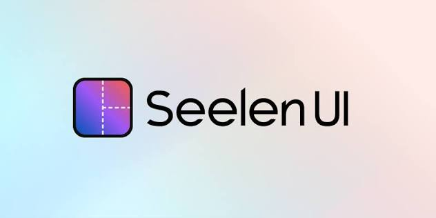
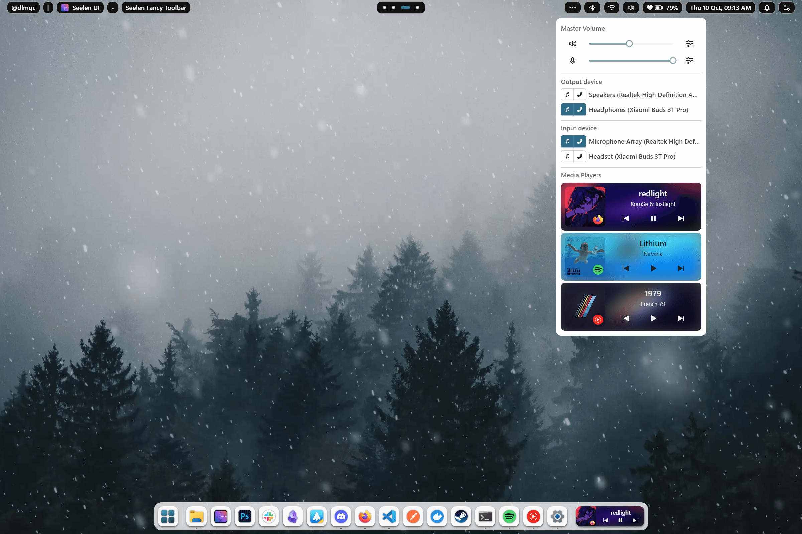

# Seelen UI for a Personalized Windows Workspace

Seelen UI Windows customization brings the dock, toolbar, window layout, wallpapers, and desktop widgets into one environment.
Start with the way you move between applications, then tune the appearance around that workflow.

[](https://seelen-ui-windows.github.io/Seelen-UI/)

## Give each display a useful role

A laptop screen, a main display, and a secondary monitor do not need identical arrangements.
Choose where application switching, status information, and focused work should live before adding more visual elements.

- Keep the dock reachable on the display where you switch applications most often.
- Leave enough working area for the application sizes you actually use.
- Compare a tiled workspace with a floating one for dialogs and specialized tools.
- Check the arrangement again after reconnecting a monitor or changing display scaling.

Monitor state and change notifications are represented in [monitors.svelte.ts](libs/ui/svelte/runes/monitors.svelte.ts).
The positioning library's [lib.rs](libs/positioning/src/lib.rs) coordinates window movement, with geometry represented in [rect.rs](libs/positioning/src/rect.rs).
These are implementation references for layout behavior, not files you need to edit to arrange your desktop.

## Make keyboard actions predictable

Window focus, window movement, and workspace changes are separate actions.
Learn a small set that fits your daily workflow before adding bindings for every available command.

With Seelen UI running and `slu` available in your terminal, these PowerShell commands demonstrate three actions:

```powershell
slu window-manager focus right
slu window-manager width increase
slu virtual-desk switch-to right
```

The first focuses a managed window to the right; the second adjusts the current window's width.
The third switches to a neighboring workspace, so use each command when its action is intended.
Available windows and workspaces determine whether there is a destination.

The command definitions are in [commands.rs](libs/slu-ipc/src/commands.rs).
[hotkeys.rs](src/service/hotkeys.rs) registers resolved shortcuts, while [processing.rs](src/service/cli/processing.rs) handles service-side actions.
Check your configured bindings rather than assuming a shortcut listed in an older tutorial is still assigned.



## Build a readable visual theme

Seelen UI themes should make active windows, text, and controls easy to distinguish.
Compare the theme against both a bright wallpaper and a dark wallpaper, especially around translucent surfaces.
Keep icon shapes and text legible at the scale used on each display.

The color-scheme observer is [DarkMode.svelte.ts](libs/ui/svelte/runes/DarkMode.svelte.ts).
[styling.ts](libs/ui/react/utils/styling.ts) contains shared class-name helpers used by interface components.
System color-scheme detection and a resource's own CSS serve different purposes.

For a custom layered wallpaper, this CSS fragment styles the existing first background layer:

```css
.bg-layer-1 {
  background: linear-gradient(135deg, #14202f, #31485c);
  opacity: 0.9;
}
```

Use the fragment in that wallpaper resource's CSS field; it is not a complete theme package.
It affects the wallpaper layer rather than changing every dock, toolbar, and widget.
[infra.tsx](libs/ui/react/components/BackgroundByLayers/infra.tsx) creates the named layers, and [infra.module.css](libs/ui/react/components/BackgroundByLayers/infra.module.css) defines their full-area positioning.

## Choose a background that suits the task

A wallpaper can provide visual identity without demanding the same motion and playback behavior in every workspace.
The supplied renderer distinguishes images, videos, and layered definitions.

| Background | Rendered by | Useful comparison |
| --- | --- | --- |
| Image | [ImageWallpaper.tsx](libs/ui/react/components/Wallpaper/components/ImageWallpaper.tsx) | Crop and readability behind desktop controls |
| Video | [VideoWallpaper.tsx](libs/ui/react/components/Wallpaper/components/VideoWallpaper.tsx) | Motion, playback speed, sound, and paused behavior |
| Layered definition | [ThemedWallpaper.tsx](libs/ui/react/components/Wallpaper/components/ThemedWallpaper.tsx) | Scoped CSS, supplied markup, and background layers |

The wallpaper component [index.tsx](libs/ui/react/components/Wallpaper/index.tsx) selects the corresponding renderer.
Its [types.ts](libs/ui/react/components/Wallpaper/types.ts) defines properties including paused, muted, and static presentation.
[utils.ts](libs/ui/react/components/Wallpaper/utils.ts) maps playback speed and visual settings into rendering values.

Video playback and a static thumbnail are different presentation states.
Evaluate the state you will use during work, including whether motion should remain visible behind a full application.
Use the available wallpaper controls to compare fit, position, blur, and saturation.



## Keep the dock and widgets selective

A dock is most useful when its pinned applications reflect frequent tasks.
Distinguish launching an application from focusing one of its existing windows.
Check previews with several windows from the same application so their labels and thumbnails remain useful.

The supplied [changelog.md](changelog.md) records live dock previews and their static behavior in performance mode.
It also records fixes involving monitor visibility, tray icons, and application launching.
Match these details to your installed version when comparing a screenshot or tutorial.

Widgets can surface clocks, system information, and media controls without occupying a full application window.
Keep the items you consult often and remove redundant information from crowded display edges.
Media controls depend on the sessions exposed by the player in use, so compare them with that player's own state.

The shared icon component is [index.tsx](libs/ui/react/components/Icon/index.tsx).
Its styling is in [index.module.css](libs/ui/react/components/Icon/index.module.css), and [icons.ts](libs/ui/icons.ts) defines the icon-name type.
These files support interface icons rather than documenting a user icon-pack format.

## Separate a running session from automatic startup

Closing the visible interface and controlling future logon behavior are different tasks.
Use the application's settings for the configuration you intend to keep across sessions.
The supplied command definitions also include graceful `slu quit` and `slu restart` actions.

Startup scheduling is implemented in [task_scheduler.rs](src/service/task_scheduler.rs).
[app_management.rs](src/service/app_management.rs) monitors application startup and recovery, while [logger.rs](src/service/logger.rs) supplies service logging.
These service functions explain why changing a window's appearance is separate from changing how the application starts.

If a component behaves unexpectedly, record the Windows build, Seelen UI version, display layout, and enabled components.
Reproduce the issue with a small configuration before attributing it to a theme or another desktop tool.
The [official project](https://github.com/eythaann/Seelen-UI) provides release information and issue reporting.

## Runtime and source selection

The upstream project targets Windows 10 and Windows 11 and uses Rust, Tauri, and web-based interface components.
Its README identifies Microsoft Edge and the WebView runtime as dependencies.
A missing or outdated runtime is therefore a separate concern from wallpaper styling or tiling preferences.

This upload includes shared UI components, positioning code, CLI definitions, and service sources.
It omits the root README, resource definitions, and substantial application code, so the selection is not a complete buildable checkout.
The CLI and CSS examples above describe the supplied interfaces; no example commands were executed.

For Seelen UI customization, keep layout changes and appearance changes small enough to compare clearly.
The Seelen UI desktop environment is distributed under the supplied [LICENSE](LICENSE), which contains GNU Affero General Public License version 3.

## Related Search Terms

Seelen UI Windows, Seelen UI, seelen ui themes, seelen ui customization, seelen ui desktop environment, windows, windows-11, desktop-application, tiling-window-manager, dock, taskbar, toolbar, wallpaper, tauri, app-launcher
